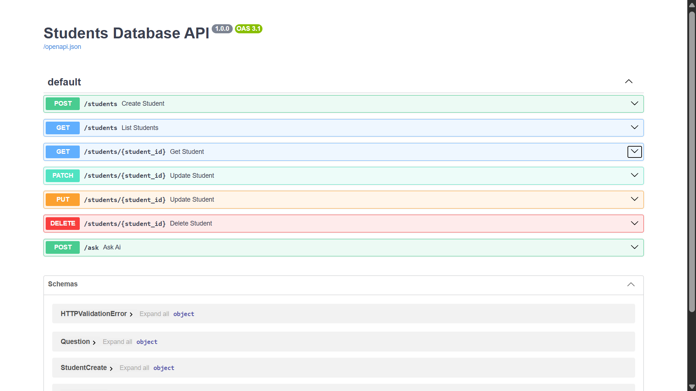
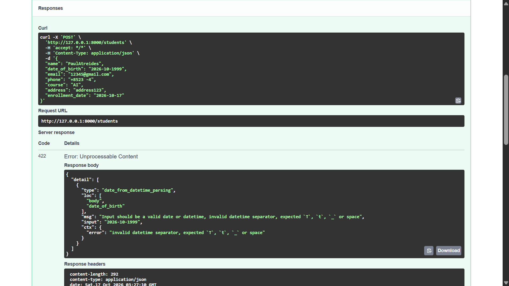
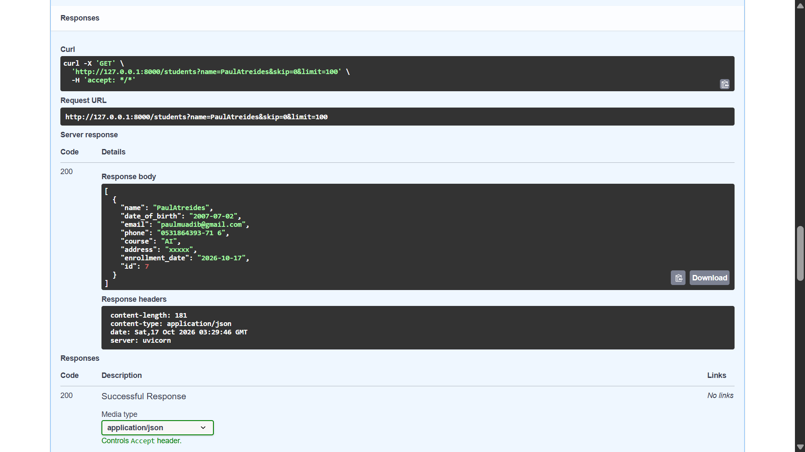
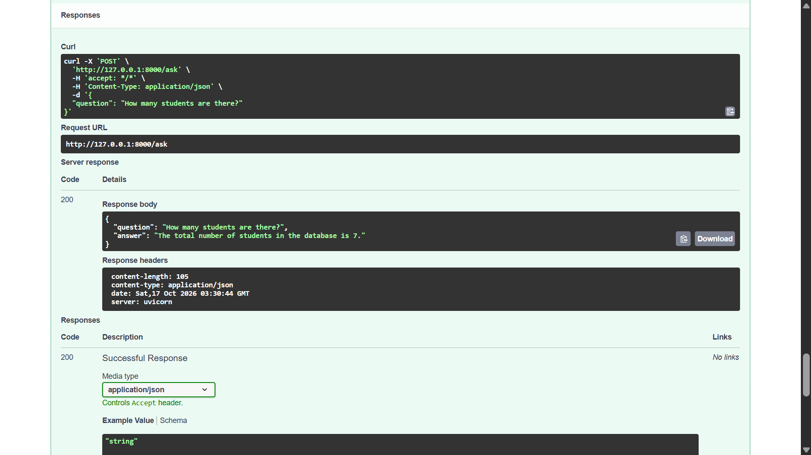

# Students Database CRUD API

Python backend for managing student records. Built with **FastAPI** + **SQLite** (SQLAlchemy).
Includes an optional local-AI endpoint using **Ollama**.

## Features

- Create, read (list/filter/single), update, delete students
- Input validation (email format, phone format, DOB in the past, at least one contact)
- 404 for missing records, 409 for duplicate emails
- Auto-generated docs at `/docs`
- Optional: `/ask` endpoint answers natural-language questions using Ollama (no model-generated SQL)

## Prerequisites

- Python 3.10+
- (Optional) [Ollama](https://ollama.com) for the AI bonus

## Installation

```bash
git clone <your-repo-url>
cd students-crud
python -m venv .venv
source .venv/bin/activate      # Windows: .venv\Scripts\activate
pip install -r requirements.txt
```

## Run

```bash
python seed.py                 # optional: loads 5 dummy students
uvicorn app.main:app --reload
```

Open http://127.0.0.1:8000/docs to try every endpoint.

## Endpoints

| Method      | Endpoint               | Purpose                                                                        |
| ----------- | ---------------------- | ------------------------------------------------------------------------------ |
| POST        | /students              | Create a student                                                               |
| GET         | /students              | List / filter (`name`, `course`, `born_after`, `born_before`, `skip`, `limit`) |
| GET         | /students/{student_id} | View a student                                                                 |
| PUT / PATCH | /students/{student_id} | Update details (partial updates supported)                                     |
| DELETE      | /students/{student_id} | Delete a student                                                               |
| POST        | /ask                   | (Optional) Ask AI about the data                                               |

## Sample requests

```bash
# Create
curl -X POST http://127.0.0.1:8000/students -H "Content-Type: application/json" \
  -d '{"name":"Asha Rao","date_of_birth":"2005-04-12","email":"asha@example.com","course":"CSE"}'

# List with filter
curl "http://127.0.0.1:8000/students?born_after=2005-01-01"

# Get one
curl http://127.0.0.1:8000/students/1

# Update
curl -X PATCH http://127.0.0.1:8000/students/1 -H "Content-Type: application/json" \
  -d '{"course":"Data Science"}'

# Delete
curl -X DELETE http://127.0.0.1:8000/students/1
```

## Optional: Local AI with Ollama

```bash
ollama pull llama3.2:1b
ollama serve                   # skip if already running
curl -X POST http://127.0.0.1:8000/ask -H "Content-Type: application/json" \
  -d '{"question":"How many students are there?"}'
curl -X POST http://127.0.0.1:8000/ask -H "Content-Type: application/json" \
  -d '{"question":"List students born after 2005"}'
```

Design: the backend fetches records with fixed, parameterised queries and passes them
to the model as context. The model never executes SQL. Override model/host with
`OLLAMA_MODEL` and `OLLAMA_URL` env vars.

## Tests

```bash
pytest
```

## Project structure

```
app/
  main.py      # routes
  models.py    # SQLAlchemy model
  schemas.py   # Pydantic validation
  crud.py      # DB operations
  database.py  # engine/session
  ai.py        # Ollama bonus
seed.py        # dummy data
tests/
```

## Screenshots

### API docs



### Create a student



### List students



### Ask AI (Ollama)



## Notes

Only dummy data is used. No secrets or real student information are committed 
